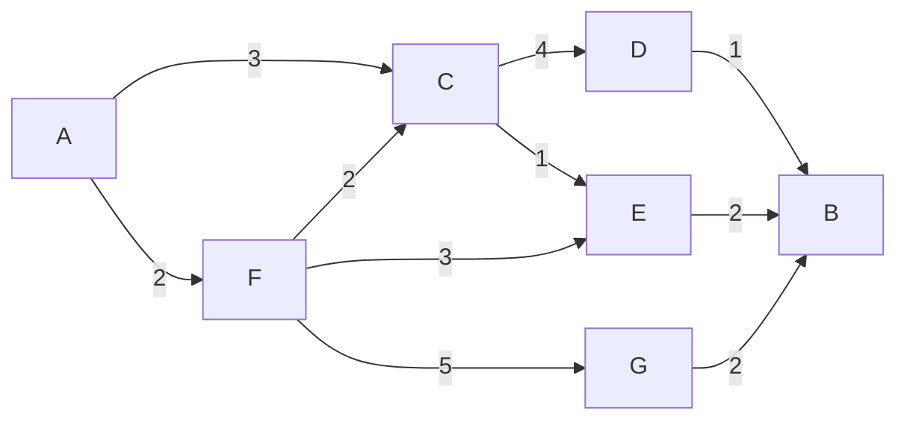

### Dijkstra's Algorithm — explained like you're new to it 🏆

Imagine you're driving and want the **cheapest (fastest) route** from your house to every other place in town, and you know the toll cost of every road. You don't know the best route yet, so you explore **greedily**: always drive toward whichever reachable place is currently cheapest to get to, and keep a running "best price so far" for everywhere else. That's all Dijkstra's algorithm is — a disciplined way of doing that exploration so you never have to backtrack.

It finds the **shortest path from one starting point (source) to every other point** in a graph, as long as none of the road costs (edge weights) are negative.

---

### The Rules & Steps

#### 1️⃣ Set up your "best price so far" board

- Write down a cost for every node: the start node costs `0` to reach (you're already there), and every other node costs `Infinity` (you don't know a way there yet).
- Keep a **"came from" note** for each node — which node you'd travel from to get there — so you can retrace the route later.
- Use a **priority queue (min-heap)**: a to-do list that always hands you the cheapest unexplored option first, instead of you having to scan the whole list yourself.

---

#### 2️⃣ Always expand the cheapest known option next

- Grab the node with the smallest cost from the to-do list.
- Mark it as **done** — you've locked in its true shortest cost, it won't get cheaper later.
- Look at each of its neighbors and ask: _"If I go through this node, is it cheaper to reach my neighbor than whatever I had recorded before?"_
  ```
  costThroughHere = costOfCurrentNode + weightOfRoadToNeighbor
  ```
- If `costThroughHere` is **cheaper** than the neighbor's current best price:
  - **Update** the neighbor's price.
  - **Update** the "came from" note for that neighbor.
  - **Add the neighbor to the to-do list** with its new, cheaper price.

This "is there a cheaper way now?" check is called **relaxing an edge**.

---

#### 3️⃣ Keep going until there's nothing left to explore

- Repeat step 2 until the to-do list is empty (or every node is marked done).
- The price board now holds the **true shortest cost** from the start to every node you could reach.

---

#### 4️⃣ Retrace the actual route

- To get the real path to any node, start at that node and keep following the **"came from" notes backward** until you land back on the start node.
- Reverse that trail and you have the shortest route, in order.

---

### The Important Fine Print

✔ Works on **weighted graphs** — but only if every weight is **zero or positive**.  
✔ With a priority queue, it's fast: **O((V + E) log V)**.  
✘ **Breaks with negative weights** — a "discount" road could make an already-finalized node's price wrong. Use **Bellman-Ford** instead if negative weights are possible.

---

### Walking Through an Example



Starting from `A`, trying to reach `B`:

- `A → F` costs `2`, `A → C` costs `3` — so `F` is cheaper, explore it first.
- From `F`, reaching `C` would cost `2 + 2 = 4`, which is **more** than the `3` we already have for `C` — so we keep `C`'s price at `3`, no update.
- From `C` (price `3`), reaching `E` costs `3 + 1 = 4` — cheaper than anything we had, so `E`'s price becomes `4`.
- From `E` (price `4`), reaching `B` costs `4 + 2 = 6`.
- Other routes to `B` (via `D` or `G`) end up more expensive, so they lose.

✔ **Shortest path**: `A → C → E → B`  
✔ **Total cost**: `3 + 1 + 2 = 6`

---

### Video Walkthrough

[Dijkstra's Algorithm Explained](https://www.youtube.com/watch?v=F3PNsWE6_hM)
