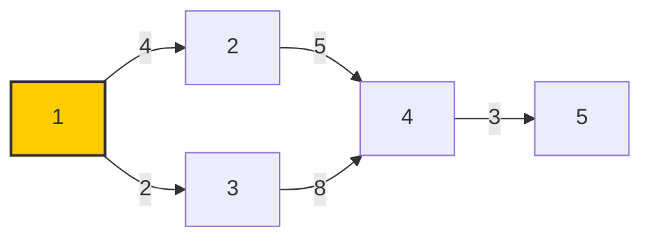
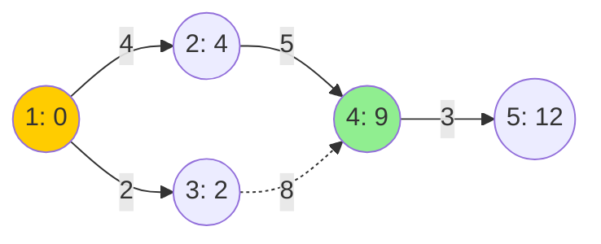

# Network Delay Time — Dijkstra's Algorithm

Implementation: [networkDelay.js](./networkDelay.js)
(LeetCode 743 — "Network Delay Time")

## Problem

You are given `n` network nodes labeled `1..n`, and a list of travel times as directed edges `times[i] = [u, v, w]`, where `u` is the source node, `v` is the target node, and `w` is the time it takes for a signal to travel from `u` to `v`.

A signal is sent from node `k`. Return the time it takes for **all `n` nodes to receive the signal**. If it's impossible for all nodes to receive the signal, return `-1`.

This is a direct application of **single-source shortest path** on a weighted, directed graph with non-negative weights — exactly what Dijkstra's algorithm solves. The answer is the **largest** shortest distance from `k`, since that's the last node to receive the signal.

## Example (the input used in the code)

```js
n = 5;
k = 1;
times = [
  [1, 2, 4],
  [1, 3, 2],
  [2, 4, 5],
  [3, 4, 8],
  [4, 5, 3],
];
```



Node `1` is the source (highlighted). Dijkstra explores outward, always expanding the closest unvisited node next.

## How the implementation works

### 1. `MinHeap` — the priority queue

A binary min-heap is built from scratch (no library) to always pop the node with the **smallest known distance** next:

- `push(val)` → append then `heapifyUp` to restore heap order.
- `pop()` → swap root with last element, remove last, then `heapifyDown` to restore order.
- Heap entries are `[node, distance]` pairs, compared by `distance` (index `1`).

This gives `O(log V)` insert/extract instead of the `O(V)` linear scan a naive "find min distance" approach would need.

### 2. Graph representation

```js
let adjacencyList = new Map();
for (let [u, v, wt] of times) {
  adjacencyList.get(u).push([v, wt]);
}
```

An adjacency list (`node -> [[neighbor, weight], ...]`) is used instead of a matrix — more efficient for sparse graphs like this one.

### 3. `djikstra()` — the core algorithm

```js
function djikstra() {
  let pq = new MinHeap((a, b) => a[1] - b[1]);
  let visited = new Array(n + 1).fill(false);
  let distance = new Array(n + 1).fill(Infinity);
  distance[k] = 0;
  pq.push([k, 0]);

  while (pq.length() > 0) {
    let [u, dist] = pq.pop();
    if (visited[u]) continue;
    visited[u] = true;

    for (let [nbr, nbrDist] of adjacencyList.get(u)) {
      if (!visited[nbr]) {
        let newDist = dist + nbrDist;
        if (newDist < distance[nbr]) {
          distance[nbr] = newDist;
          pq.push([nbr, newDist]);
        }
      }
    }
  }
  return distance;
}
```

Steps, matching the standard Dijkstra rules:

1. **Initialize**: every node's distance is `Infinity` except the source `k`, which is `0`. Push `[k, 0]` onto the heap.
2. **Pick closest unvisited node**: pop the heap — it always returns the smallest remaining distance.
3. **Skip stale entries**: if `u` was already visited, `continue` (this heap can hold outdated duplicate entries for a node, so re-checking `visited` is what makes that safe).
4. **Relax neighbors**: for each unvisited neighbor, compute `dist + edgeWeight`. If it's smaller than the neighbor's current known distance, update it and push the new `[neighbor, newDist]` pair.
5. **Repeat** until the heap is empty — at that point `distance[]` holds the shortest distance from `k` to every node.

### 4. `networkDelayTime()` — turning distances into the answer

```js
function networkDelayTime() {
  let distance = djikstra();
  let ans = 0;
  for (let i = 1; i <= n; i++) {
    if (distance[i] === Infinity) return -1;
    ans = Math.max(ans, distance[i]);
  }
  return ans;
}
```

- If **any** node is still `Infinity`, it was never reached → return `-1`.
- Otherwise, the answer is the **maximum** of all shortest distances — the time for the _last_ node to receive the signal.

> Note: the original file had this loop sitting outside `djikstra()`, referencing a `distance` variable that didn't exist in that scope. It's now wrapped in `networkDelayTime()`, which calls `djikstra()` and returns the final result.

## Trace for the example

| Step | Popped `[node, dist]` | Visited set   | Distance array `[1,2,3,4,5]` |
| ---- | --------------------- | ------------- | ---------------------------- |
| 0    | —                     | `{}`          | `[0, ∞, ∞, ∞, ∞]`            |
| 1    | `[1, 0]`              | `{1}`         | `[0, 4, 2, ∞, ∞]`            |
| 2    | `[3, 2]`              | `{1,3}`       | `[0, 4, 2, 10, ∞]`           |
| 3    | `[2, 4]`              | `{1,3,2}`     | `[0, 4, 2, 9, ∞]`            |
| 4    | `[4, 9]`              | `{1,3,2,4}`   | `[0, 4, 2, 9, 12]`           |
| 5    | `[5, 12]`             | `{1,3,2,4,5}` | `[0, 4, 2, 9, 12]`           |

Final distances: `[0, 4, 2, 9, 12]` → every node reachable → **answer = `max(...) = 12`**.



The dashed edge `3 -> 4` (weight 8) is **not** part of the shortest-path tree — node `4` is reached via `1 → 2 → 4` (cost `9`) instead of `1 → 3 → 4` (cost `10`).

## Complexity

- **Time**: `O((V + E) log V)` — each edge may push onto the heap (`O(log V)`), and each node is popped once.
- **Space**: `O(V + E)` for the adjacency list, distance array, visited array, and heap.

## Why Dijkstra applies here

- All edge weights (travel times) are **non-negative** — a requirement for Dijkstra's greedy choice to be valid (a negative edge could make a path shorter _after_ a node is marked visited, which Dijkstra can't revisit).
- We need the shortest distance from a **single source** (`k`) to **all** other nodes — exactly Dijkstra's use case, as opposed to Bellman-Ford (handles negative weights) or Floyd-Warshall (all-pairs).

## Run it

```bash
node src/algorithms/Dijkstra-shortest-path/networkDelay.js
# => 12
```
